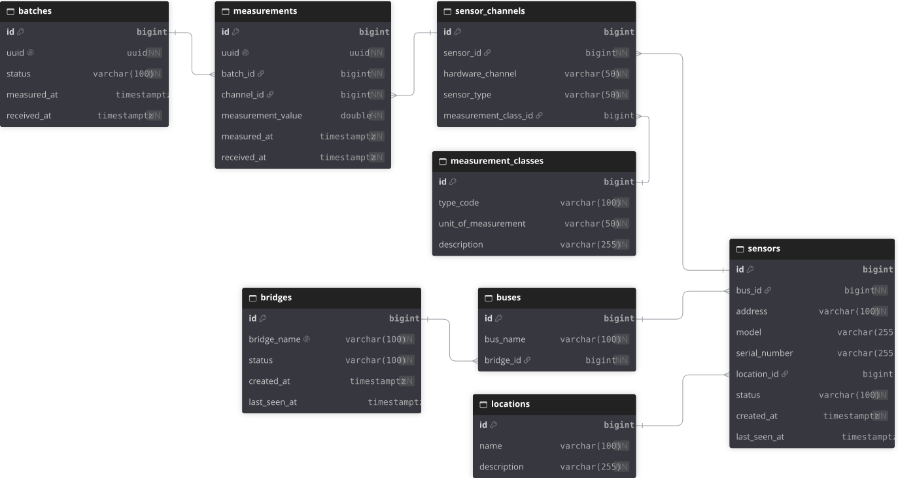

# PiSense
Система сбора телеметрии с датчиков, подключённых к Raspberry Pi.

## Стек
`Java 21` · `Spring Boot 3.3.2` · `Spring MVC` · `Spring Data JPA` · `PostgreSQL 16` · `H2` · `Pi4J 2.6.0` · `Lombok` · `Maven` · `Docker Compose` · `Spring Boot Actuator` · `Swagger UI` · `JUnit` / `Mockito`

## Предметная область

* **Bridge - приложение на Raspberry Pi, единица приёма данных.** Планировщик живёт на нём, он периодически сканирует шины
  (`i2c1`, `i2c2`, `spi`, `onewire`) и отправляет на сервер batch и генерирует `uuid`.
  Поэтому `batches.bridge_id` и идемпотентность по `batches.uuid` ложатся естественно.
* **Измерение относится к каналу и описывается парой `sensorCode` + `channelName`.** У датчика бывает несколько каналов, и у каждого свои
  `metric_type` и `unit`.
* **Топология нормализована, а факты хранятся узкими строками:** `batch_id`, `channel_id`, `measurement_value`, `measured_at`.
  Это нужно для таблицы, которая будет самой большой.
* **server** — Spring Boot приложение. Принимает discovery, хранит топологию в PostgreSQL
  и отдаёт REST API. Приём batch описан в API в формате Swagger UI в docker-compose: <http://localhost:8081>.
* **common** — общие DTO и enum'ы.

| Понятие | Описание |
|---|---|
| Bridge | Устройство на базе Raspberry Pi, единица приёма данных |
| Bus (шина) | Цифровая шина bridge: I2C, SPI, 1-Wire |
| Sensor (датчик) | Устройство на шине, имеет один и более измерительных каналов |
| Channel (канал) | Измеряемая величина датчика: имя, тип метрики, единица измерения |
| Batch | Посылка со всеми измерениями одного цикла опроса bridge, имеет `uuid` |
| Measurement | Одно значение канала в момент времени |

## Схема базы данных

Схема строится вокруг **bridge**. Это корень двух ветвей:

* **Топология:** `bridge → bus → sensor → sensor_channel`.
  Она меняется редко и описывает, что физически подключено.
* **Поток данных:** `bridge → batch → measurement`.
  Она растёт постоянно и содержит основной объём данных.

Ветви сходятся в `sensor_channels`. Измерение ссылается на канал (`measurements.channel_id`), а канал через цепочку
датчик → шина → мост приводит обратно к bridge. По сути это схема «звезда»: узкая таблица фактов `measurements`
и небольшие таблицы-измерения вокруг неё.

По структуре корнем является `bridge`, а по нагрузке и смыслу центр схемы — пара `measurements` + `sensor_channels`.
Большинство запросов выглядит как «история значений канала за период».

## ER-диаграмма

Схема БД v3. Описание в DBML — [`docs/pisense-er.dbml`](docs/pisense-er.dbml) (можно открыть на [dbdiagram.io](https://dbdiagram.io)),
исполняемый скрипт — [`server/src/main/resources/schema.sql`](server/src/main/resources/schema.sql).
<p align="center">
  
</p>

## Таблицы

| Таблица | Назначение | Уникальность |
|---|---|---|
| `bridges` | Мосты. `name` приходит в URL запросов | `name` |
| `buses` | Шины моста (`i2c1`, `i2c2`, `spi0`, `onewire`) | `(bridge_id, name)` |
| `sensors` | Датчики на шине. `sensor_code` формирует bridge: `<шина>-<адрес>`, например `i2c1-0x76` | `(bus_id, sensor_code)` |
| `sensor_channels` | Каналы датчика: `name`, `metric_type`, `unit` | `(sensor_id, name)` |
| `batches` | Посылки. `uuid` генерирует bridge | `uuid` |
| `measurements` | Измерения: `batch_id`, `channel_id`, `measurement_value`, `measured_at` | `(batch_id, channel_id)` |

## Идемпотентность

1. Bridge формирует batch и генерирует `batchId` (UUID) **до** отправки. При повторе используется тот же `batchId`.
2. Сервер в одной транзакции вставляет строку в `batches` и все строки в `measurements`.
3. Если `batches.uuid` уже есть (проверка по уникальному индексу, а не `if` в Java, чтобы не было гонки),
   сервер ничего не пишет и сообщает, что batch уже был принят.

Если ответ потерялся, bridge безопасно повторяет отправку.

## API

Контракт: [`docs/pisense-api.yaml`](docs/pisense-api.yaml) (OpenAPI 3.0). Swagger UI в docker-compose: <http://localhost:8081>.

Ошибки возвращаются в едином формате `ErrorResponse` (`error`, `description`).
Сейчас реализован `BridgeController`; остальные эндпоинты из контракта находятся в разработке.

## Запуск

```bash
cp .env.example .env
docker compose up -d --build                      # bridge в режиме mock, server, PostgreSQL, Swagger UI
docker compose -f docker-compose.yml -f docker-compose.pi.yml up -d   # на Raspberry Pi с реальными шинами
```

| Сервис | Порт |
|---|---|
| pisense-bridge | 8080 |
| pisense-server | 9090 |
| PostgreSQL | 127.0.0.1:5432 |
| Swagger UI | 8081 |

Настройки bridge (`bridge/src/main/resources/application.properties`): имя моста (`bridges.name`, идёт в URL запросов),
`pisense.poll-interval-ms`, `pisense-server.url`.

Таблицы создаются скриптом `server/src/main/resources/schema.sql` (`spring.sql.init.mode=always`); скрипт идемпотентен.

## Структура репозитория

```
common/   общие DTO и enum'ы
bridge/   приложение на Raspberry Pi: драйверы шин, планировщик, клиент
server/   приём discovery, JPA-сущности, REST API
docs/     pisense-api.yaml (OpenAPI), pisense-er.dbml (схема БД)
```
